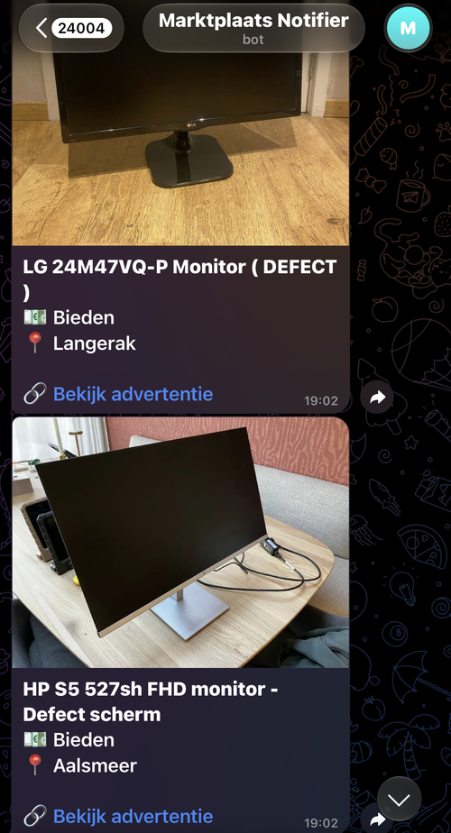

# 🛒 Marktplaats Notifier


A C# console app that watches [Marktplaats.nl](https://www.marktplaats.nl) searches and sends new listings straight to your phone via Telegram, usually within about a minute of being posted. Much faster than Marktplaats' own saved searches.

<p align="center">
  
</p>

## Features

- **Fast**: one request per category instead of one per search, so a full round takes about 10 seconds and new listings arrive within about a minute
- Each search has its **own max price**
- Only sends **new** listings — seen listing IDs are saved to a file, so nothing is sent twice, even after a restart
- Telegram messages with the listing **photo**, bold title, price, city, distance, date and a link
- Shows "Bieden", "Gratis" or "Zie omschrijving" instead of a fake €0 price
- Optional **category per search**, so "pc defect" doesn't send you car parts
- Optional **skip words per search**: skip listings that mention e.g. `barst` or `waterschade`. Pieces of text with "geen" or "zonder" are ignored, so "geen waterschade" is not skipped
- 🚨 **Super deal alerts**: a fixed price at or below half of the search's max price gets a loud 🚨 SUPER DEAL 🚨 message
- 🚨 **Urgent searches**: mark a search as `urgent` and every new listing from it gets a loud 🚨 URGENT 🚨 message
- **Quiet nights**: between 23:00 and 07:00 normal listings arrive silently, super deals and urgent searches still make a sound
- **Shipping or nearby**: listings must offer shipping, or be pickup-only within the distance you chose from your postcode
- **Telegram commands** to manage your searches from your phone: `/add` (with category buttons), `/remove`, `/list`, `/cancel`, `/help`
- Skips "Gezocht" (wanted), "Inkoop" (buying) and repair-service ads
- Quiet first round after every start, so you don't get flooded with hundreds of old listings
- Crash protection: a network hiccup or an odd listing is logged and skipped instead of stopping the bot
- **Error warnings**: after 5 failed requests in a row you get a ⚠️ message in Telegram, and a ✅ when it works again
- **Slows down by itself**: if Marktplaats answers 429 "too many requests", the bot pauses 2 minutes
- Friendly error messages: a typo in `searches.txt` or a wrong token is explained instead of crashing

## Built with

- **C# / .NET** – console app with top-level statements
- **HttpClient** + **async/await** – fetching search results
- **System.Text.Json** – parsing the listing data
- **Telegram Bot API** – sending the notifications

## How it works

1. Groups your searches by category
2. Per category, fetches the 100 newest listings from Marktplaats' search endpoint (`/lrp/api/search`) in **one** request. Searches without a category get their own request, like a normal Marktplaats search
3. Skips listings it has already seen
4. Checks every new listing against the searches of that category: all search words must appear in the title or description
5. Applies the search's filters: wanted/repair ads, skip words, max price, pickup distance
6. Decides if it's a super deal or comes from an urgent search, and sends it to Telegram (`sendPhoto` / `sendMessage`, HTML formatting), silently at night unless it's urgent

📖 Want to know what every file and method does? See [**How it works (code guide)**](docs/HOW-IT-WORKS.md).

## Setup

**Not a programmer?** Follow the step-by-step [**Setup guide**](SETUP.md). No coding needed.

**For developers:** you need .NET 6 or newer. Clone the repo and run:

```
dotnet run
```

On the first launch, the app asks for your Telegram bot token, finds your chat ID by itself, and asks for your postcode and how far you'll travel for pickup.

## Changing the searches

Edit `searches.txt`, or use `/add` and `/remove` in Telegram. Each line is one search, with up to 5 fields separated by `;`:

```
search words;max price;category;skip words;urgent
```

| Field | Required | Example | Meaning |
|---|---|---|---|
| search words | ✅ | `defect monitor` | What you type in the Marktplaats search bar |
| max price | ✅ | `60` | Max price in whole euros |
| category | optional | `322` | Only search this Marktplaats category |
| skip words | optional | `barst,strepen` | Comma separated. Listings that mention one of these are skipped |
| urgent | optional | `urgent` | Every new listing from this search gets a loud 🚨 URGENT 🚨 message |

Examples:

```
defect monitor;60;322;barst,gebarsten,strepen,lijnen,waterschade
rtx 3060;110;322
galaxy a36 defect;90;820;;urgent
iphone 13;250
```

To use a later field without an earlier one, leave the earlier one empty: `galaxy a36 defect;90;820;;urgent` has no skip words but is urgent.

Common category IDs: `322` = Computers en Software, `356` = Spelcomputers en Games, `31` = Audio, Tv en Foto, `820` = Telecommunicatie. The list is also at the top of `searches.txt`.

- Lines starting with `#` are switched off (comments). Put comments on their own line, never after a search.
- If a line has a mistake, the app tells you which line and what's wrong.
- The first round after every start is quiet, so new searches don't flood you with their old listings.
- Searches **with** a category are matched by the bot itself: every search word must be the **start of a word** in the title or the start of the description (`monitor` matches "monitoren", but `ram` doesn't match "frame"). Words with numbers are matched more loosely, so `rtx 3060`, `rtx3060` and "RTX 3060" all find each other. Searches **without** a category use Marktplaats' own search.

**Super deals** need no setup: a listing with a fixed price (not "Bieden") at or below **half** of the search's max price is always a super deal. With `rtx 3070;140`, a 3070 for €70 or less is a super deal.

## Roadmap

###  Done
- [x] Limit searches to specific Marktplaats categories
- [x] Allow pickup-only listings near my own city
- [x] Manage searches from Telegram (`/add`, `/remove`, `/list`)
- [x] Skip words per search
- [x] Super deal and urgent alerts, quiet nights
- [x] Postcode and pickup distance asked at the first launch

### 1. Reliability: never go quiet without telling you
- [x] Telegram warning after several errors in a row
- [x] Handle 429 "too many requests": wait automatically, then continue

### 2. Speed: a round every minute
- [x] One request per category instead of one per search (3 requests per round instead of 73), matching listings to searches in the bot itself
- [ ] Run the category requests at the same time (`Task.WhenAll`)
- [x] Smarter matching: whole-word starts, model numbers with or without spaces

### 3. Everything from your phone
- [ ] `/add` also asks for skip words and urgent
- [ ] Buttons in `/list` (🗑️ remove, ✏️ edit)
- [ ] `/pause` and `/resume`
- [ ] Settings via Telegram (night hours, pickup distance)
- [ ] A "Bekijk" button under every listing

### 4. For everyone
- [ ] Multi-user: one bot for friends, each with their own searches
- [ ] Run 24/7 on a cheap mini PC or a free cloud server
- [ ] Ship a short example `searches.txt` instead of my own list
- [ ] Mac and Linux release builds

### 5. Features that sound interesting
- [ ] Seller info in the message (years on Marktplaats, reviews, verified ✓)
- [ ] Price drop alerts ("📉 €80 → €45")
- [ ] Repair hints: `hints.txt` with rules like `geen beeld,geluid;💡 often backlight`, plus a question to ask the seller
- [ ] Separate Telegram group with a loud custom sound for super deals

## Note

This uses an unofficial Marktplaats endpoint, so it may change or break at any time. Keep the check interval reasonable.
