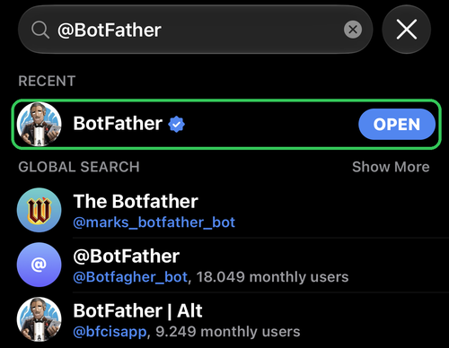

# Setup guide

No programming needed. Takes about 5 minutes.

## What you need

- **Telegram** on your phone ([iPhone](https://apps.apple.com/app/telegram-messenger/id686449807) / [Android](https://play.google.com/store/apps/details?id=org.telegram.messenger))
- A PC or Mini PC that stays on while you want alerts

---

## Step 1: Make a Telegram bot

Notifications come from your own private bot. Telegram's **@BotFather** creates one for you.

1. Open Telegram and search for **@BotFather** (the one with the blue checkmark).

   

2. Tap **Start**, then send `/newbot`.
3. Pick a **name** (e.g. `My Marktplaats Alerts`) and a **username** ending in `bot` (e.g. `jan_marktplaats_bot`).

   

4. BotFather gives you a **token** like `123456789:ABCdef...`. Copy it.

   

> Keep your token private. Anyone with it can control your bot. If you ever leak it, send `/revoke` to BotFather.

---

## Step 2: Download and run

1. Download the latest zip from the [**Releases**](../../releases) page and unzip it into a folder.
2. Double-click **MarktplaatsNotifier**.
   - On Windows you may see a blue "Windows protected your PC" screen because the app isn't code-signed. Click **More info → Run anyway**.
3. Paste your bot token and press **Enter**.
4. Open your new bot in Telegram and send it any message (like `hi`).

   

5. Enter your **postcode** (like `1234AB`) and **how many km** you're willing to drive for pickup (`0` = shipping only).

Done. You won't be asked again. The first check for each search is quiet so you don't get flooded with old listings.


---

## Step 3: Using the bot from your phone

Send **`/menu`** in Telegram to open the button menu. From there you can do everything without touching any files:

- **Add a search**: tap **Add Search**, type something like `rtx 3070 under 140`, or paste a Marktplaats search URL straight into the chat.
- **Edit or delete searches**: tap **Searches** (or **Find** to jump straight to one). Tap any search to change its max price, toggle Urgent, edit skip words, run a live **Check now**, or delete it.
- **Watch a listing**: tap **Watch** under any listing the bot sends you, or use **Share → Telegram → your bot** from the Marktplaats app. You'll get an alert if the price drops, someone bids higher, or it gets reserved/sold.
- **Settings**: change your postcode, pickup km, quiet night hours, language (English / Dutch), and business filters.
- **Snooze**: pause alerts for 1 hour, 3 hours, or until tomorrow 08:00.
- **Backup & Restore**: tap **Backup** to get a `.zip` file in Telegram. Send that `.zip` back to the bot anytime to restore everything.

### Editing `searches.txt` directly (optional)

If you prefer editing a file on your PC, open `searches.txt` in Notepad. Each line is:

```text
search words;max price;category;skip words;urgent
```

Examples:

```text
defect monitor;60;322;barst,strepen,waterschade
rtx 3060;110;322
ps5 defect;120;356/2954;;urgent
iphone 13;250
```

Save the file and the bot reloads it automatically within a couple seconds. Lines starting with `#` are ignored.

---

## Quiet nights and alerts

- Fixed-price listings at or below **half** your max price get a loud **SUPER DEAL** alert.
- Price drops and `urgent` searches also make a sound, even at night.
- Between **23:00 and 07:00** (changeable in `/settings`), normal listings arrive silently, and you get a short morning summary at 07:00.

---

## Troubleshooting

| Problem | Fix |
|---|---|
| "That token doesn't work" | Copy the token from BotFather again with no extra spaces. |
| Nothing arrives right away | The first check of each search is quiet. Send `/test` to check that alerts work, or open a search in `/list` and tap **Check now**. |
| "5 errors in a row" in Telegram | Marktplaats is temporarily rate-limiting or your internet dropped. The bot slows down and keeps retrying on its own. |
| Change postcode or pickup km | Send `/settings` in Telegram (or edit lines 3 and 4 of `secrets.txt`). |
| Start over | Delete `secrets.txt` and `seen.txt`, then start the app again. |
