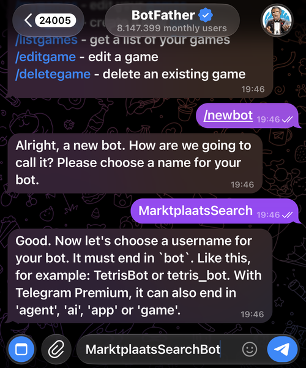
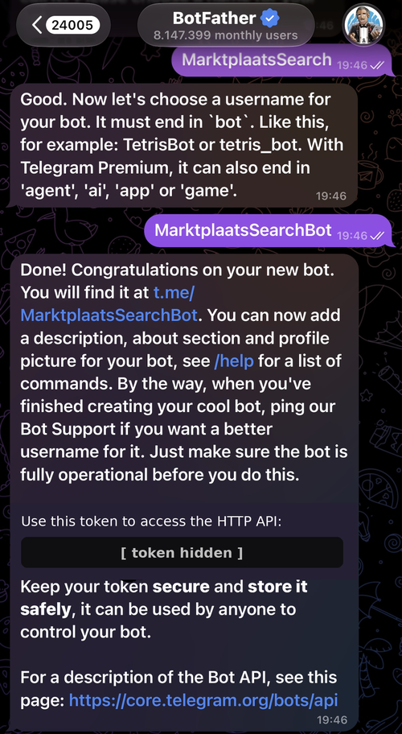
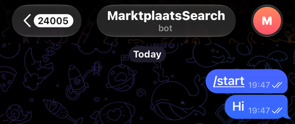
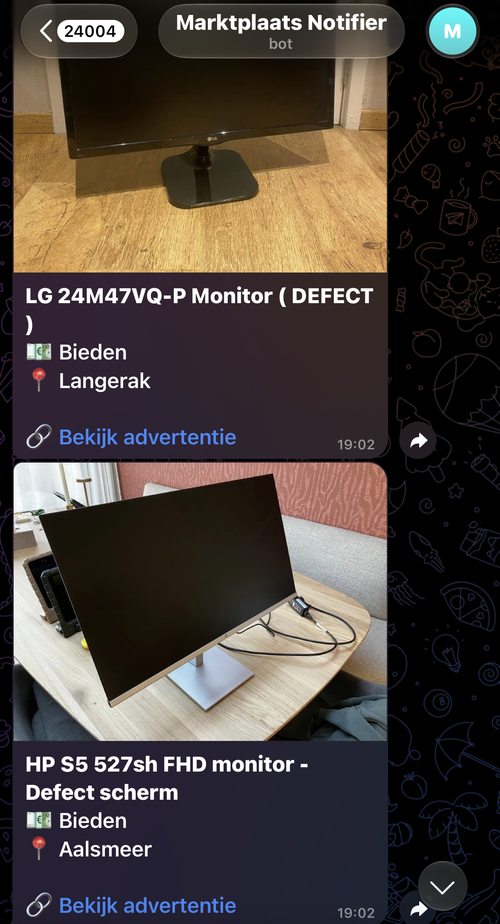

# 📱 Setup guide

No programming knowledge needed. This takes about 5 minutes.

## What you need

- **Telegram** on your phone ([iPhone](https://apps.apple.com/app/telegram-messenger/id686449807) / [Android](https://play.google.com/store/apps/details?id=org.telegram.messenger))
- A computer that stays on while you want notifications

---

## Step 1: Create your own Telegram bot

The notifications come from your own private bot. Telegram's official **BotFather** makes one for you.

1. Open Telegram and search for **@BotFather**. Pick the one with the **blue checkmark** ✔️. Others are fakes.

   

2. Tap **Start**, then send:
   ```
   /newbot
   ```

3. BotFather asks for a **name**. This is what you'll see in your chat list, e.g. `My Marktplaats Alerts`.

4. Then it asks for a **username**. It has to end with `bot` and be unique, e.g. `jan_marktplaats_bot`.

   

5. BotFather now sends you a **token**: a long code like `123456789:ABCdef...`. Copy it. You'll need it in step 3.

   

> ⚠️ **Keep your token secret.** Anyone who has it can control your bot. If you ever leak it, send `/revoke` to BotFather to get a new one.

---

## Step 2: Download the app

1. Go to the [**Releases**](../../releases) page of this project.
2. Download the file for your computer (e.g. `MarktplaatsNotifier-windows.zip`) and **unzip** it into a folder.

**Windows:** the first time you open it, you may see a blue **"Windows protected your PC"** screen. That's because the app isn't signed (signing costs money), not because it's dangerous. Click **More info → Run anyway**.

---

## Step 3: First launch

1. Double-click **MarktplaatsNotifier**. A black window opens.
2. It asks for your token. **Paste** it (right-click in the window) and press **Enter**.
3. It asks you to message your bot. Open your new bot in Telegram (BotFather sent you a link to it), tap **Start** or send `hi`.

   

4. The window says **"Setup done!"**.
5. It asks for your **postcode**, like `1234AB`. This is used to show how far away a listing is.
6. It asks **how many km you'll travel** to pick something up. Listings that can't be shipped are only sent if they're within this distance. Type `0` if you only want listings that can be shipped.

That's it! 🎉 You won't be asked these questions again.

The first round is quiet: the app remembers all current listings without sending them. From then on, you'll only get **new** listings.



---

## Step 4: Choose what to search for

There are two ways:

**A) From your phone (easiest):** send `/add` to your bot. It asks what to search for, your max price, and a category (tap a button). Use `/list` to see your searches and `/remove rtx 3070` to remove one. Send `/help` for all commands.

**B) In `searches.txt`:** open **`searches.txt`** (in the same folder as the app) with Notepad. Every line is one search:

```
defect monitor;60;322;barst,strepen,waterschade
rtx 3060;110;322
galaxy a36 defect;90;820;;urgent
iphone 13;250
```

Each line has up to **5 parts**, separated by **`;`**. Only the first two are required:

1. **Search words**, like you'd type them on Marktplaats
2. **Max price** in whole euros
3. **Category number** (optional). `322` means "only search in Computers en Software". Leave it out to search all of Marktplaats. The most common numbers are at the top of `searches.txt`.
4. **Skip words** (optional), separated by commas. A listing that mentions one of them is skipped. Example: `barst,waterschade` skips cracked or water-damaged items. "Geen waterschade" is *not* skipped.
5. **`urgent`** (optional). Every new listing from this search makes a sound, even at night, with a 🚨 URGENT 🚨 header.

Want part 5 but not part 4? Leave part 4 empty, so you get two `;` in a row: `galaxy a36 defect;90;820;;urgent`

Save the file and restart the app. Made a typo? The app tells you which line is wrong.

Lines starting with `#` are switched off. Put notes on their own `#` line, never behind a search.

---

## 🚨 Super deals and quiet nights

- A listing with a **fixed price** (not "Bieden") that costs **half of your max price or less** is a super deal. You get a 🚨 SUPER DEAL 🚨 message that always makes a sound.
- Between **23:00 and 07:00**, normal listings arrive **silently** so they don't wake you. Super deals and urgent searches still make a sound.

---

## Keep it running

The app only checks while the black window is **open** and your computer is **awake**. Closing the window stops the notifications.

---

## Something not working?

| Problem | Fix |
|---|---|
| "That token doesn't work" | Copy the token from BotFather again, without spaces, and paste it. |
| Nothing arrives | The first round is quiet. Wait a while, new listings don't appear every minute. |
| "⚠️ 5 errors in a row" in Telegram | Marktplaats is blocking the bot for a moment, or your internet is down. The bot keeps trying by itself and sends ✅ when it works again. |
| I moved, or want a different pickup distance | Open `secrets.txt` with Notepad. Line 3 is your postcode, line 4 the distance in km. Change them, save, and restart the app. |
| I want to start over completely | Delete `secrets.txt` and `seen.txt`, then start the app. |
| "Error with '...'" lines in the window | Usually a short internet hiccup. The app keeps going by itself. |
| "Line ... in searches.txt is wrong" | Fix that line. The format is `search words;price;category;skip words;urgent`, and only the first two parts are required. Then start the app again. |
| I'm not getting alerts at night | That's on purpose: normal listings are silent from 23:00 to 07:00. Add `urgent` to a search if you want those to make a sound. |
